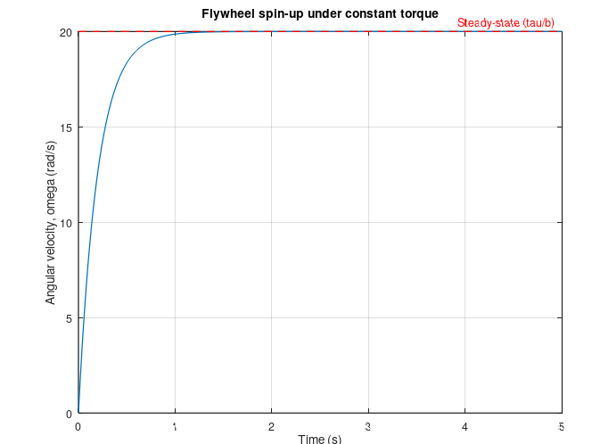

# Flywheel Energy Storage: Geometry Comparison

Which of three flywheel shapes stores the most kinetic energy before the steel reaches a safe stress limit? I modelled a solid disc, a spoked wheel and a tapered-edge disc in Fusion 360, ran a stress simulation on each, and used GNU Octave to turn the stress results into a maximum safe speed and the energy stored at that speed.

A second part models a flywheel being spun up by a motor, and checks Octave's `ode45` solver against a solution derived by hand.

## Result

| Design | Max safe speed (rad/s) | Moment of inertia (kg m²) | Energy at safe speed (kJ) |
|---|---|---|---|
| Solid disc | 1,713 | 0.0185 | 27.1 |
| Spoked wheel | 1,113 | 0.0132 | 8.2 |
| Tapered-edge disc | 2,024 | 0.0103 | 21.0 |

The tapered-edge disc can spin fastest, but it is also lighter, so it stores 78% of the solid disc's energy. Per kilogram it stores about 19% more (8.8 against 7.4 kJ/kg). Which design is better depends on whether the application is limited by mass.

## Stress analysis

**Geometry.** All three are 200 mm in diameter and 15 mm thick, with a 10 mm bore. The spoked wheel has five spokes, each 20° wide, between 30 mm and 80 mm radius, with a rim from 80 mm to the edge. The tapered-edge disc gets thinner towards the rim. The Fusion 360 files are in [`cad/`](cad/).

**Simulation.** Static stress study in Fusion 360 with an angular velocity applied about the axis and the bore held fixed. I recorded the peak von Mises stress at six speeds:

| Speed (rad/s) | Solid disc (MPa) | Spoked wheel (MPa) | Tapered edge (MPa) |
|---|---|---|---|
| 25 | 0.027 | 0.063 | 0.019 |
| 50 | 0.106 | 0.252 | 0.076 |
| 100 | 0.426 | 1.009 | 0.305 |
| 300 | 3.835 | 9.08 | 2.746 |
| 600 | 15.34 | 36.32 | 10.98 |
| 900 | 34.51 | 81.72 | 24.71 |

**Fit.** The centripetal load on every part of the disc is proportional to $\omega^2$, so the stress should be too. Plotting peak stress against $\omega^2$ gives a straight line for each design, with gradient $k$ and an intercept $c$ close to zero:

| Design | $k$ (MPa per (rad/s)²) |
|---|---|
| Solid disc | $4.26 \times 10^{-5}$ |
| Spoked wheel | $1.01 \times 10^{-4}$ |
| Tapered-edge disc | $3.05 \times 10^{-5}$ |

**Safe speed.** The material is AISI 1018 steel with the yield stress taken as 250 MPa. With a factor of safety of 2 the safe stress is 125 MPa, and

```math
\omega_{safe} = \sqrt{\frac{\sigma_{safe} - c}{k}}
```

**Energy.** $E = \tfrac{1}{2} I \omega_{safe}^2$, with each design's moment of inertia taken from Fusion 360.

## Spin-up model

A separate, simpler case: a 2 kg solid disc of radius 0.1 m driven by a constant 1 N m motor torque against a friction torque proportional to speed ($b = 0.05$).

```math
I\frac{d\omega}{dt} = \tau - b\omega, \qquad I = \tfrac{1}{2}MR^2
```

Solving with an integrating factor gives

```math
\omega(t) = \frac{\tau}{b}\left(1 - e^{-bt/I}\right)
```

which rises to a steady 20 rad/s. If the motor cuts out at 3 s, the speed then decays exponentially from its value at that moment.



**Checking `ode45` against the hand solution** (Octave 11.3):

| Run | Maximum difference from the hand solution |
|---|---|
| One `ode45` call across the whole 8 s (`flywheel_ode45.m`) | 18% of peak speed |
| Two calls, split at the cutoff (`verification_ode45.m`) | 0.0015 rad/s (under 0.01% of peak speed) |

By 3 s the wheel is at steady speed, so the adaptive solver is taking long steps, and one of them straddles the instant the torque disappears. Splitting the integration at the cutoff means no step crosses it.

## Limitations

- **Mesh convergence was not checked.** The spoked wheel's peak stress is at sharp internal corners with no fillets, so it depends on the mesh and is an estimate.
- **Not yet compared with theory.** The peak stress has not been checked against the closed-form solution for a rotating disc with a central hole (the formula is in my notes). The bore is held fixed in the simulation, which that solution does not assume.
- **Six speeds give one piece of information.** A linear static simulation scales exactly with $\omega^2$, so the fit confirms the setup is behaving but one speed would give the same gradient.
- **Yield only.** The limit is static yield with a factor of safety of 2. Fatigue and burst are not considered.

## Files

| Path | Contents |
|---|---|
| `cad/` | Fusion 360 models and a screenshot of each simulation setup |
| `stress/stress_data.csv` | Peak stress at each speed for the three designs |
| `stress/flywheel_stress_graphing.m` | Fits stress against $\omega^2$ and finds the safe speed (asks for the data points when run) |
| `stress/*.ofig` | The fitted plots, saved from Octave |
| `spin_up/flywheel_ode45.m` | Spin-up and coast-down with one `ode45` call, compared with the hand solution |
| `spin_up/verification_ode45.m` | The same, split at the cutoff |
| `notes/Flywheel_Project_Notes.pdf` | Handwritten derivations and results. An early stress derivation is crossed out as incorrect. |
